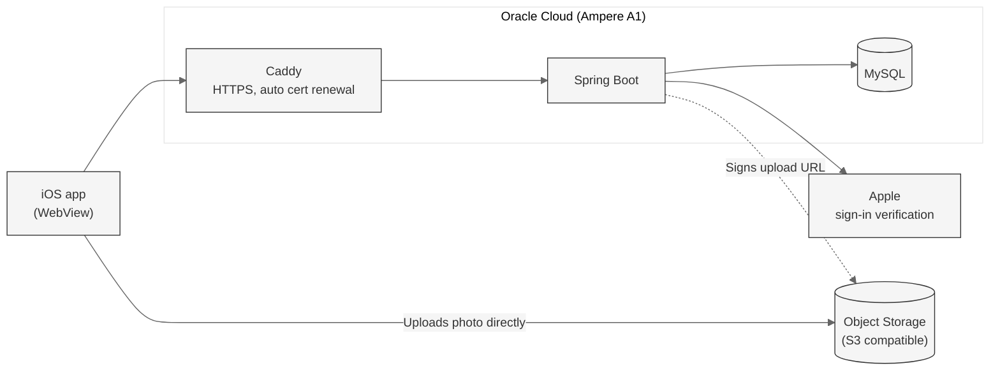
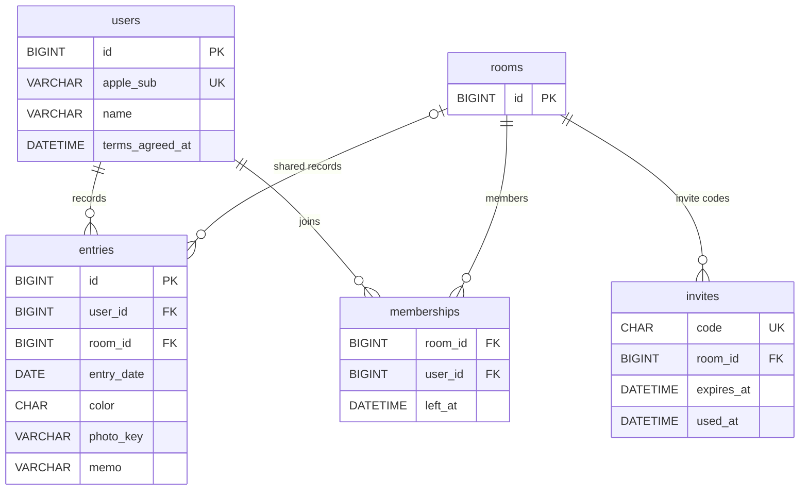
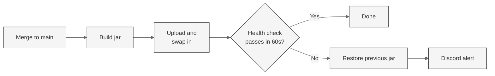

<a name="readme-top"></a>

<div align="center">

# dam. server

**API server for [dam.](https://github.com/hjkim0905/dam_FE), an iOS app that records each day as one color picked from a photo**

<a href="https://apps.apple.com/kr/app/id6809452180">App Store</a> |
<a href="https://github.com/hjkim0905/dam_FE">Frontend repo</a> |
<a href="https://bbin-guuuu.tistory.com/category/%EA%B0%9C%EC%9D%B8%20%ED%94%84%EB%A1%9C%EC%A0%9D%ED%8A%B8%28%EB%8B%B4.%29">Dev blog (Korean)</a>


<strong>Language:</strong> <a href="README.md">한국어</a> | English

[Architecture](#architecture) | [API](#api) | [Data model](#data-model) | [Deployment](#deployment) | [Run](#run)

</div>

<br>

> [!NOTE]
> The backend of a solo project where I handled everything from planning to infrastructure.
> The app overview and screenshots are in the [frontend README](https://github.com/hjkim0905/dam_FE/blob/main/README.en.md).

<br>

## At a glance

| Item | Details |
|---|---|
| API | 12 endpoints (auth, profile, records, photos, rooms) |
| Tests | 39 (focused on domain rules) |
| Server | One Oracle Cloud free-tier instance (Ampere A1), $0 per month |
| Deployment | Auto-deploys on merge to `main`, rolls back automatically if the health check fails |

<br>

## Architecture



### Photo bytes never pass through the server

The server only signs a URL for the upload. The app uploads the photo straight to object storage.

- The small free server does not carry photo traffic.
- The same photos appear on any device you sign in from.
- Photo URLs are reissued only when less than half of their lifetime remains. The same photo keeps the same URL, so the app's image cache keeps hitting. ([blog](https://bbin-guuuu.tistory.com/125))

### Caddy is the only thing facing the outside

Port 8080 is never opened. Caddy terminates HTTPS and forwards to Spring Boot, and it also issues and renews certificates.

<br>

## API

All paths start with `/api/v1`.

| Method | Path | Description |
|---|---|---|
| `POST` | `/auth/apple` | Verifies the Apple sign-in token and issues a session token |
| `GET` | `/me` | My profile |
| `POST` | `/me/onboarding` | Saves name and terms agreement |
| `PATCH` | `/me` | Changes name |
| `DELETE` | `/me` | Deletes account |
| `GET` | `/entries` | Records in a date range (mine, or my room's) |
| `POST` | `/entries` | Saves today's color, photo, and memo |
| `DELETE` | `/entries/{id}` | Deletes a record |
| `POST` | `/photos/upload-url` | Issues a signed URL for uploading a photo |
| `POST` | `/rooms/invites` | Issues a 6-digit invite code |
| `POST` | `/rooms/join` | Joins a room with an invite code |
| `DELETE` | `/rooms/me` | Leaves the room |

Filters check three things on every request. ([`security/`](src/main/java/app/dam/security))

1. Is the session token valid?
2. Has onboarding been completed? (If not, only onboarding APIs are allowed)
3. Is the app version at or above the minimum supported version? (If not, responds with an update notice)

<br>

## Data model



- **One record per day**: `(user_id, entry_date)` is unique, so a day cannot be saved twice.
- **Leaving a room keeps the records**: memberships are not deleted, only `left_at` is set. Queries go by the room you are in now, so rejoining a room with the same person brings the records back.
- **Schema changes go through Flyway only**: migrations stack up in order in [`db/migration`](src/main/resources/db/migration).

<br>

## Deployment

On merge to `main`, GitHub Actions builds the jar, uploads it to the server, and swaps it in. ([`cd.yml`](.github/workflows/cd.yml))



- Without rollback, one bad deployment would leave the server down. This rollback kicked in during the first real deployment failure. ([`release.sh`](deploy/release.sh))
- The commit hash is set as the Sentry release, so every error can be traced to its deployment.
- Initial server setup (firewall, Java, MySQL, Caddy, systemd) is a single run of [`setup.sh`](deploy/setup.sh).

<br>

## Tech stack

| Area | Choice | Why |
|---|---|---|
| Server | Java 21, Spring Boot 4, Spring Security | Auth filters and error handling follow the standard approach |
| Auth | Sign in with Apple, OAuth2 Resource Server (JWT) | One sign-in path, with the server issuing its own session token |
| Data | JPA, MySQL, Flyway | `ddl-auto` is validate, so the server refuses to start if entities and tables disagree |
| Photos | Object Storage (AWS SDK S3) | S3-compatible API, so the code stays the same across clouds |
| Infra | Oracle Cloud A1, Caddy, systemd | Runs entirely on the free tier |
| Ops | GitHub Actions, Sentry, Discord | A failed deployment reaches a human right away |

<br>

## Run

Create one schema in MySQL. Flyway creates the tables.

```sh
mysql -u root -p -e "CREATE DATABASE dam DEFAULT CHARACTER SET utf8mb4 COLLATE utf8mb4_0900_ai_ci;"
```

Fill in the connection settings and start the server.

```sh
cp .env.example .env      # fill in the values
set -a; source .env; set +a; ./gradlew bootRun
```

`APPLE_PRIVATE_KEY` is the contents of the .p8 file. It is read whether or not the header is included and however the line breaks come in.

```sh
./gradlew test
```

<details>
<summary><b>Trying the API locally</b></summary>

Sign in with Apple is the only login, so you need an identityToken from the app before the rest works.

```sh
API=http://localhost:8080/api/v1

# Sign in
curl -s -X POST $API/auth/apple -H 'Content-Type: application/json' \
  -d '{"identityToken":"...","authorizationCode":"...","fullName":"Jiho"}'

# Onboarding
curl -s -X POST $API/me/onboarding -H "Authorization: Bearer $TOKEN" \
  -H 'Content-Type: application/json' \
  -d '{"name":"Jiho","termsAgreed":true,"privacyAgreed":true}'

# Get an upload URL, upload directly to it, then save the record
curl -s -X POST $API/photos/upload-url -H "Authorization: Bearer $TOKEN" \
  -H 'Content-Type: application/json' \
  -d '{"contentType":"image/jpeg","contentLength":48213}'
curl -s -X PUT "$UPLOAD_URL" --data-binary @photo.jpg
curl -s -X POST $API/entries -H "Authorization: Bearer $TOKEN" \
  -H 'Content-Type: application/json' \
  -d '{"date":"2026-09-03","color":"#8A9A7B","photoKey":"'"$KEY"'","memo":"The fog was lifting"}'
```

</details>

<br>

## Good to know

- **Sign in with Apple is the only login.** There is no dev bypass login. With one door, you only have to lock that door.
- **The server starts even with empty storage settings.** Only photo calls answer that they are not ready, and everything else keeps working.
- **Never edit the schema by hand.** `ddl-auto` is validate, so the server will not start if entities and tables disagree. To change something, add the next numbered file to `db/migration`.
- **Account deletion really deletes the row.** `apple_sub` is UNIQUE, so keeping deleted rows would block re-signup with the same Apple account. I caught this before launch while reviewing the DB schema directly.

<div align="right"><a href="#readme-top">Back to top</a></div>
