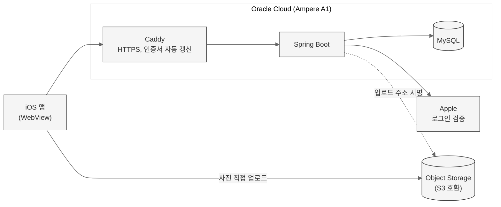
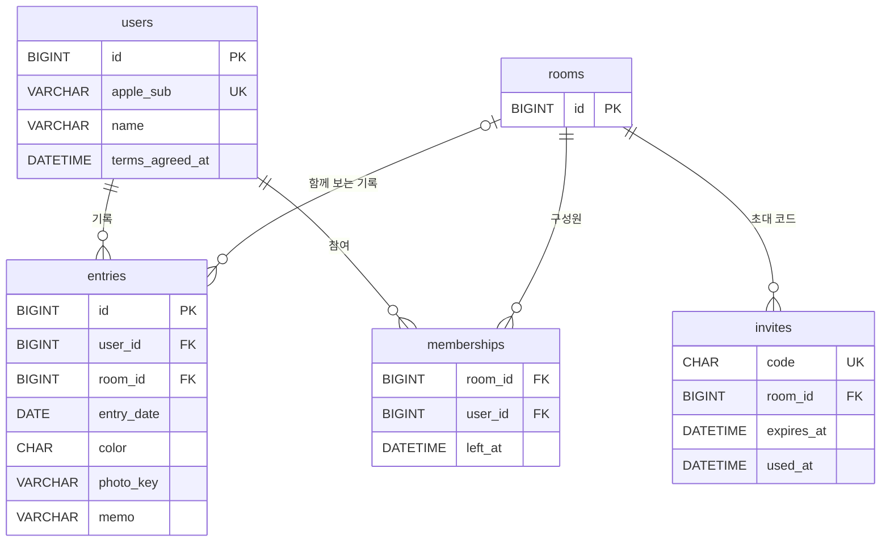
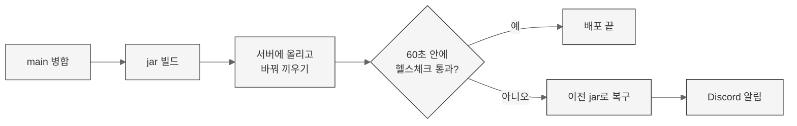

<a name="readme-top"></a>

<div align="center">

# 담. 서버

**사진에서 고른 색 하나로 하루를 남기는 iOS 앱 [담.](https://github.com/hjkim0905/dam_FE)의 API 서버**

<a href="https://apps.apple.com/kr/app/id6809452180">App Store</a> |
<a href="https://github.com/hjkim0905/dam_FE">프론트엔드 레포</a> |
<a href="https://bbin-guuuu.tistory.com/category/%EA%B0%9C%EC%9D%B8%20%ED%94%84%EB%A1%9C%EC%A0%9D%ED%8A%B8%28%EB%8B%B4.%29">개발 블로그</a>


[아키텍처](#아키텍처) | [API](#api) | [데이터 모델](#데이터-모델) | [배포](#배포) | [돌리기](#돌리기)

</div>

<br>

> [!NOTE]
> 기획부터 인프라까지 혼자 맡은 개인 프로젝트의 백엔드입니다.
> 앱 소개와 화면은 [프론트엔드 README](https://github.com/hjkim0905/dam_FE)에 있습니다.

<br>

## 한눈에 보기

| 항목 | 내용 |
|---|---|
| API | 12개 (인증, 내 정보, 기록, 사진, 방) |
| 테스트 | 39개 (도메인 규칙 중심) |
| 서버 | Oracle Cloud 무료 구간 (Ampere A1) 1대, 월 비용 0원 |
| 배포 | `main`에 병합되면 자동 배포, 헬스체크 실패 시 이전 버전으로 자동 복구 |

<br>

## 아키텍처



### 사진 바이트는 서버를 거치지 않는다

서버는 사진을 올릴 자리에 서명만 하고, 사진은 앱이 오브젝트 스토리지에 직접 올립니다.

- 작은 무료 서버가 사진 전송량을 떠안지 않습니다.
- 어느 기기로 로그인해도 같은 사진이 보입니다.
- 사진 주소는 유효기간이 절반 아래로 남았을 때만 새로 발급합니다. 같은 사진은 같은 주소로 가서 앱의 이미지 캐시가 그대로 맞습니다. ([블로그](https://bbin-guuuu.tistory.com/125))

### 바깥을 보는 것은 Caddy 하나

8080 포트는 열지 않습니다. Caddy가 HTTPS를 받아 Spring Boot로 넘기고, 인증서 발급과 갱신도 Caddy가 맡습니다.

<br>

## API

모든 경로는 `/api/v1`로 시작합니다.

| 메서드 | 경로 | 설명 |
|---|---|---|
| `POST` | `/auth/apple` | 애플 로그인 토큰을 검증하고 세션 토큰을 발급 |
| `GET` | `/me` | 내 정보 |
| `POST` | `/me/onboarding` | 이름과 약관 동의 저장 |
| `PATCH` | `/me` | 이름 변경 |
| `DELETE` | `/me` | 회원 탈퇴 |
| `GET` | `/entries` | 기간 안의 기록 (나, 또는 내가 속한 방) |
| `POST` | `/entries` | 오늘의 색, 사진, 메모 저장 |
| `DELETE` | `/entries/{id}` | 기록 삭제 |
| `POST` | `/photos/upload-url` | 사진을 올릴 서명된 주소 발급 |
| `POST` | `/rooms/invites` | 6자리 초대 코드 발급 |
| `POST` | `/rooms/join` | 초대 코드로 방 참여 |
| `DELETE` | `/rooms/me` | 방 나가기 |

요청마다 필터가 세 가지를 확인합니다. ([`security/`](src/main/java/app/dam/security))

1. 세션 토큰이 유효한가
2. 온보딩을 마쳤는가 (안 마쳤으면 온보딩 API만 허용)
3. 앱 버전이 최소 지원 버전 이상인가 (아니면 업데이트 안내 응답)

<br>

## 데이터 모델



- **하루에 기록 하나**: `(user_id, entry_date)`가 유니크라 같은 날 두 번 저장되지 않습니다.
- **방을 나가도 기록은 남는다**: 멤버십은 지우지 않고 `left_at`만 채웁니다. 조회는 지금 속한 방을 기준으로 돌아서, 다시 같은 사람과 방을 맺으면 기록이 그대로 돌아옵니다.
- **스키마는 Flyway로만 바꾼다**: [`db/migration`](src/main/resources/db/migration)에 번호 순서대로 쌓습니다.

<br>

## 배포

`main`에 병합되면 GitHub Actions가 jar를 빌드해 서버에 올리고 바꿔 끼웁니다. ([`cd.yml`](.github/workflows/cd.yml))



- 되돌리지 않으면 배포 한 번 잘못해서 서버가 내려간 채로 남습니다. 실제 첫 배포 장애 때 이 복구가 동작했습니다. ([`release.sh`](deploy/release.sh))
- 어느 배포에서 난 오류인지 알 수 있게 커밋 해시를 Sentry 릴리스로 심습니다.
- 서버 최초 설정(방화벽, Java, MySQL, Caddy, systemd)은 [`setup.sh`](deploy/setup.sh) 한 번으로 끝납니다.

<br>

## 기술 스택

| 영역 | 선택 | 왜 |
|---|---|---|
| 서버 | Java 21, Spring Boot 4, Spring Security | 인증 필터와 예외 처리를 표준 방식으로 묶습니다 |
| 인증 | 애플 로그인, OAuth2 Resource Server (JWT) | 로그인 문을 하나로 두고, 서버는 자체 세션 토큰을 발급합니다 |
| 데이터 | JPA, MySQL, Flyway | `ddl-auto`는 validate라 엔티티와 테이블이 어긋나면 서버가 뜨지 않습니다 |
| 사진 | Object Storage (AWS SDK S3) | S3 호환 API라 클라우드를 바꿔도 코드가 그대로입니다 |
| 인프라 | Oracle Cloud A1, Caddy, systemd | 무료 구간만으로 운영합니다 |
| 운영 | GitHub Actions, Sentry, Discord | 배포 실패를 사람이 바로 알게 합니다 |

<br>

## 돌리기

MySQL에 스키마를 하나 만듭니다. 테이블은 Flyway가 만듭니다.

```sh
mysql -u root -p -e "CREATE DATABASE dam DEFAULT CHARACTER SET utf8mb4 COLLATE utf8mb4_0900_ai_ci;"
```

접속 정보를 넣고 띄웁니다.

```sh
cp .env.example .env      # 값을 채운 뒤
set -a; source .env; set +a; ./gradlew bootRun
```

`APPLE_PRIVATE_KEY`는 .p8의 내용입니다. 머리말이 있든 없든, 줄바꿈이 어떻게 들어오든 읽습니다.

```sh
./gradlew test
```

<details>
<summary><b>로컬에서 API 확인하기</b></summary>

로그인은 애플 하나뿐이라 앱에서 받은 identityToken이 있어야 그 뒤가 돕니다.

```sh
API=http://localhost:8080/api/v1

# 로그인
curl -s -X POST $API/auth/apple -H 'Content-Type: application/json' \
  -d '{"identityToken":"...","authorizationCode":"...","fullName":"지호"}'

# 온보딩
curl -s -X POST $API/me/onboarding -H "Authorization: Bearer $TOKEN" \
  -H 'Content-Type: application/json' \
  -d '{"name":"지호","termsAgreed":true,"privacyAgreed":true}'

# 사진 자리 받고, 그 자리에 직접 올리고, 기록으로 저장
curl -s -X POST $API/photos/upload-url -H "Authorization: Bearer $TOKEN" \
  -H 'Content-Type: application/json' \
  -d '{"contentType":"image/jpeg","contentLength":48213}'
curl -s -X PUT "$UPLOAD_URL" --data-binary @photo.jpg
curl -s -X POST $API/entries -H "Authorization: Bearer $TOKEN" \
  -H 'Content-Type: application/json' \
  -d '{"date":"2026-09-03","color":"#8A9A7B","photoKey":"'"$KEY"'","memo":"안개가 걷히고 있었다"}'
```

</details>

<br>

## 알아둘 것

- **로그인은 애플 하나뿐이다.** 개발용 우회 로그인을 두지 않는다. 문이 하나면 그 문만 잠그면 된다.
- **스토리지 설정이 비어 있어도 서버는 뜬다.** 사진 관련 호출만 준비되지 않았다고 답하고 나머지는 그대로 돈다.
- **스키마는 손으로 고치지 않는다.** `ddl-auto`가 validate라 엔티티와 테이블이 어긋나면 뜨지 않는다. 바꿀 게 있으면 `db/migration`에 다음 번호 파일을 더한다.
- **회원탈퇴는 행을 진짜로 지운다.** `apple_sub`이 UNIQUE라 탈퇴한 행을 남겨두면 같은 애플 계정으로 다시 가입할 수 없다. 이 문제는 DB 스키마를 직접 검토하다 출시 전에 발견했다.

설계 문서(DB 스키마, ERD, API 명세서)는 노션의 `[BE] Spring Boot 서버 구축` 아래에 있습니다.

<div align="right"><a href="#readme-top">맨 위로</a></div>
